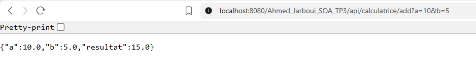
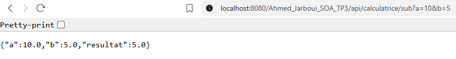
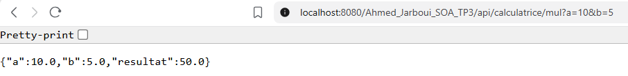
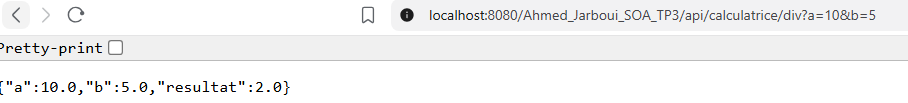
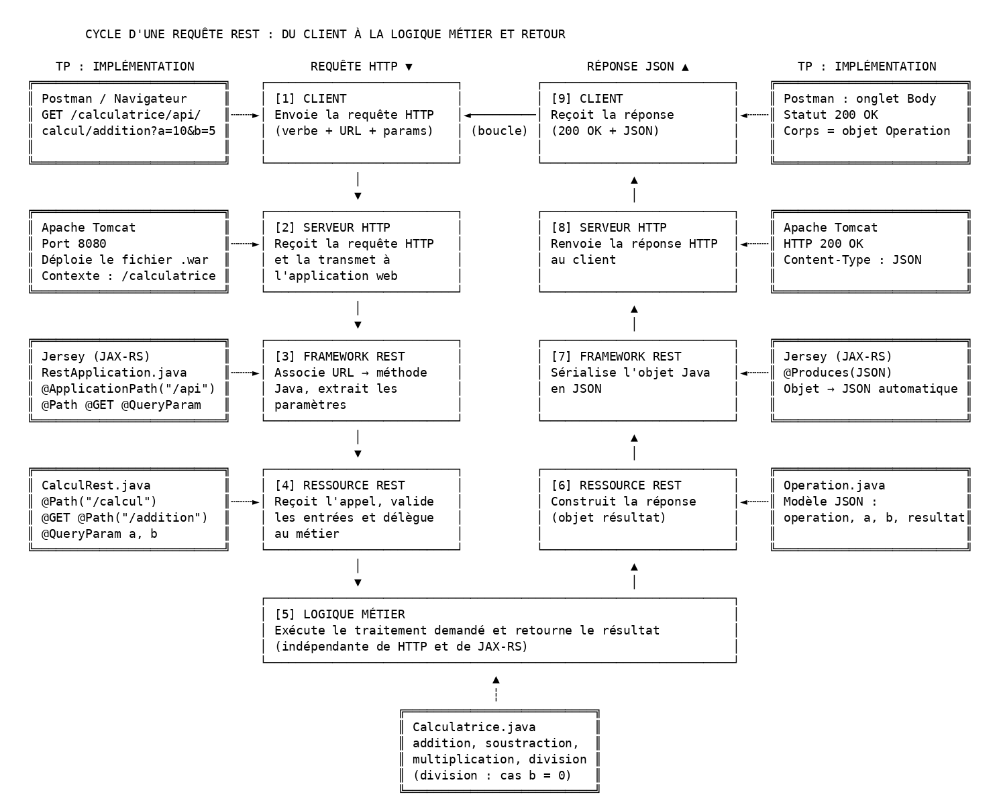

# TP 3 : Développement d'un Service REST Calculatrice

## 1. Environnement Technique

**Outils globaux :**
* **Langage :** Java 25
* **Framework REST :** JAX-RS (Implémentation Jersey 2.41)
* **Serveur Web :** Apache Tomcat 9.0.124
* **Outil de test :** Postman
* **Gestionnaire de dépendances :** Maven

**Détail par étape du TP :**
* **Étape 1 (Création Maven) :** Configuration du `pom.xml` avec le packaging `.war` pour le déploiement.
* **Étape 2 (Configuration JAX-RS) :** Ajout des dépendances `jersey-container-servlet`, `jersey-hk2` et `jersey-media-json-jackson`.
* **Étape 3 (Classe métier) :** Développement en Java pur de `Calculatrice.java` (sans annotations REST).
* **Étape 4 (Modèle JSON) :** Création du JavaBean `Operation.java` avec ses getters/setters pour la sérialisation.
* **Étape 5 (Ressource REST) :** Utilisation des annotations (`@Path`, `@GET`, `@QueryParam`, `@Produces`) et activation via `RestApplication.java`.
* **Étape 6 (Déploiement) :** Génération du `.war` (`mvn clean package`) et déploiement dans le dossier `webapps` de Tomcat.
* **Étape 7 (Tests) :** Vérification des 4 endpoints via Postman sur `localhost:8080`.
## 2. Description du fonctionnement de l'API
Le service expose une API REST permettant d'effectuer 4 opérations mathématiques (Addition, Soustraction, Multiplication, Division). L'API respecte le style architectural REST : elle est **sans état (stateless)**, utilise les méthodes HTTP standard (`GET`), et manipule des représentations de ressources au format JSON.

**Flux de fonctionnement :**
1. Le client (Postman) envoie une requête HTTP GET avec les paramètres `a` et `b` dans l'URL (ex: `?a=10&b=5`).
2. **Tomcat** intercepte la requête et la transmet au moteur **Jersey** grâce au chemin de base `/api` défini dans `RestApplication.java`.
3. **Jersey** analyse l'URL et la dirige vers la méthode correspondante dans `CalculRest.java` (ex: `@Path("/add")`).
4. Les paramètres `a` et `b` sont extraits via `@QueryParam` et transmis à la classe métier **`Calculatrice.java`** qui effectue le calcul.
5. Le résultat est encapsulé dans un objet **`Operation.java`**.
6. Grâce à l'annotation `@Produces(MediaType.APPLICATION_JSON)`, Jersey sérialise automatiquement l'objet Java en JSON.
7. Le serveur renvoie la réponse HTTP avec le code `200 OK` et le JSON au client.

## 3.  Captures d'écran Postman

### 1. Addition (GET)
* **URL :** `http://localhost:8080/Ahmed_Jarboui_SOA_TP3/api/calculatrice/add?a=10&b=5`
  

### 2. Soustraction (GET)
* **URL :** `http://localhost:8080/Ahmed_Jarboui_SOA_TP3/api/calculatrice/sub?a=10&b=5`
  

### 3. Multiplication (GET)
* **URL :** `http://localhost:8080/Ahmed_Jarboui_SOA_TP3/api/calculatrice/mul?a=10&b=5`
  

### 4. Division (GET)
* **URL :** `http://localhost:8080/Ahmed_Jarboui_SOA_TP3/api/calculatrice/div?a=10&b=5`
  

## 4. Schéma de l’architecture REST

